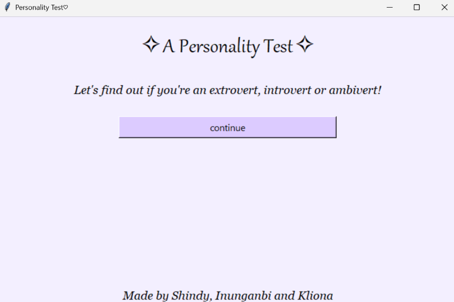
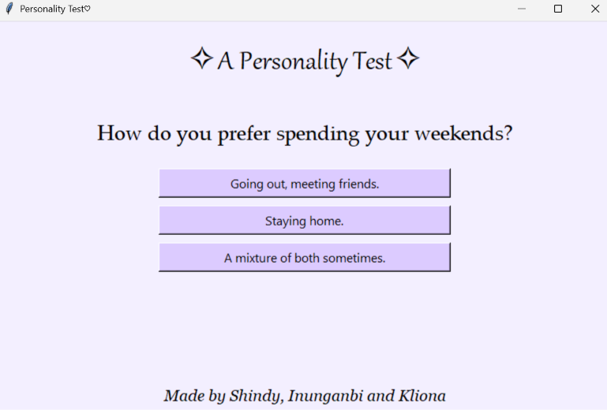
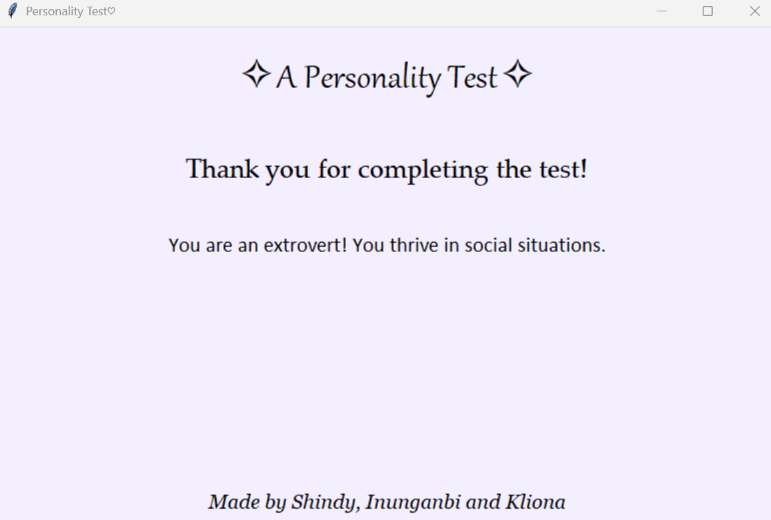

# Personality Test 🧩

An interactive personality quiz built using **Python and Tkinter**, designed to explore whether a person leans towards being an Introvert, Extrovert or Ambivert through a series of multiple-choice questions.

## 📌 About the Project

This project was developed as part of my high school final-year Computer Science school project.

Having worked with Python and other programming languages through school, I wanted to experiment with something beyond traditional console-based programs. This led me to explore **Tkinter**, Python's GUI toolkit, and create my first interactive GUI-based project.

The program presents users with a series of questions, evaluates their responses and generates a personality-based result.

## ✨ Features

- Interactive graphical user interface.
- 11 multiple-choice personality questions.
- Three response options for each question.
- A scoring system based on user responses.
- Percentage-based result calculation.
- Final personality classification: Introvert, Extrovert or Ambivert.

## 📸 Screenshots

### Welcome Screen


### Quiz Interface


### Final Result


## 🛠️ Technologies Used

- **Python** – Core programming language.
- **Tkinter** – For creating the graphical user interface.

## 📚 What I Learned

While developing this project, I explored:

- Creating application windows using `Tk()`.
- Working with GUI widgets such as Labels and Buttons.
- Handling button interactions using functions and lambda expressions.
- Implementing conditional logic and scoring mechanisms.
- Updating GUI elements dynamically.
- Calculating percentages and displaying results.

## ▶️ How to Run

1. Make sure Python 3 is installed on your computer.
2. Clone this repository:

   ```bash
   git clone https://github.com/shinhuining/Personality-test.git
   ```

3. Navigate to the project directory:

   ```bash
   cd Personality-test
   ```

4. Run the Python file:

   ```bash
   python test.py
   ```

## 🚀 Future Improvements

There is still plenty of room to explore and improve this project. Some ideas include:

- Exploring more Tkinter widgets and GUI functionalities.
- Improving the interface and overall user experience.
- Adding more customization options.

## 👩‍💻 Developer

Created by **Shindy**

A student exploring Python, GUI development and software creation.

---

*This is a beginner-level educational project and a small step in my programming journey.*
